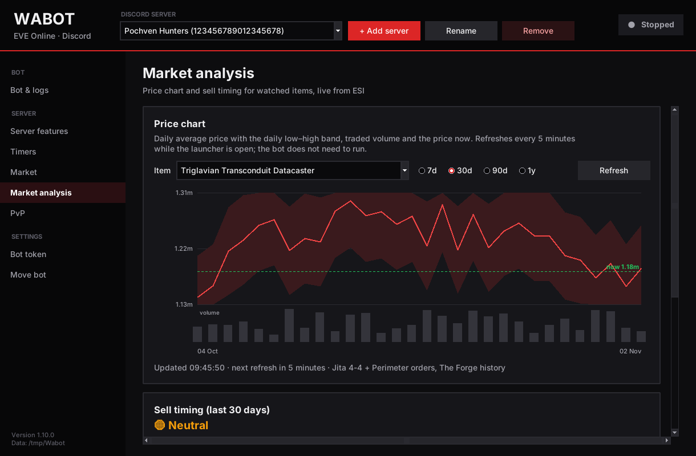
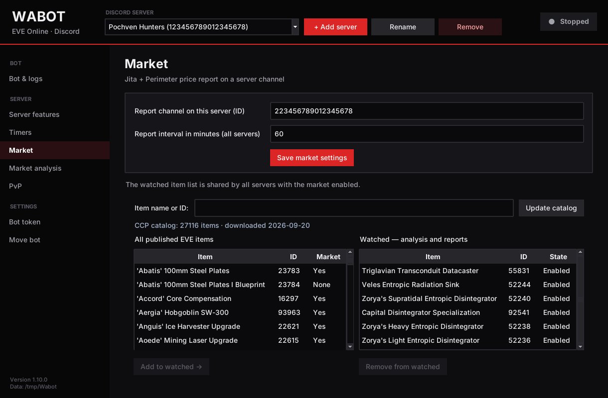
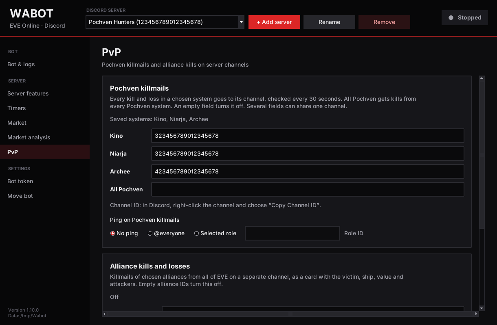

# Wabot

[](https://github.com/EasyK0/WaBotEve/actions/workflows/ci.yml)
[](https://github.com/EasyK0/WaBotEve/releases)
[](https://www.python.org/)
[](LICENSE)

A Discord bot for EVE Online groups that run sites in Pochven. It schedules site-respawn reminders, keeps completion leaderboards, posts Jita/Perimeter market reports with a 30-day sell-timing verdict, and streams killmails from Pochven and chosen alliances. It runs 24/7 on a VPS with Docker, or on a Windows PC through a desktop launcher.


<sub>Desktop launcher, Market analysis page. Screenshots use demo data.</sub>

## Features

**Respawn timers**
- `/timer time:20:20 system:Kino` records a completed site and schedules an `@everyone` reminder 23 minutes after the payout. Payout times are in EVE time (UTC), and a payout typed just after midnight correctly counts as the previous day.
- `/stats` and `/rank` show completions per system and a paginated leaderboard per server, with standard competition ranking (1, 1, 3).
- Reminders survive restarts and are never sent twice (see [Reliability](#reliability)).

**Market**
- Hourly report for watched items, combining Jita 4-4 and Perimeter into one market: best buy/sell, depth at those prices, spread, and a *safe volume* above a price floor, with 🟢 SAFE / 🟠 LOW DEPTH / 🔴 STOP status.
- `/market-analysis` and 📈 buttons under each report: a 30-day verdict from ESI price history (where today's price sits in the month's range, trend, best weekday to sell).
- `/market-now` and `/market-status` let admins post a report on demand and check that the data is fresh.
- Item search over the full CCP static data export (27,000+ types). Works offline and updates from CCP on request.

**PvP**
- Killmails from Kino, Niarja, Archee or all of Pochven, polled every 30 s from zKillboard's R2Z2 feed, each system routed to its own channel.
- Alliance kills and losses from anywhere in EVE as rich cards, with an optional `@here` above a set ISK value.

**Operations**
- One bot serves many Discord servers, and each feature can be switched on per server.
- Every message text is editable, with a live preview.
- Desktop launcher (Tkinter) with start/stop, logs, settings, statistics corrections and one-click data transfer to another PC.

| | |
|---|---|
|  |  |

## Architecture

```
Discord gateway ──► commands.py ──► repository.py ──► SQLite (WAL, versioned migrations)
                                                         │
                         queue.py  (single worker, 5 s) ◄┘──► transport.py ──► Discord REST
                         market.py (hourly)  ──► market_esi.py ──► ESI (ETag/Expires cache, paging)
                         pvp.py    (30 s)    ──► pvp_feed.py   ──► zKillboard R2Z2
                         backup.py (24 h)    ──► SQLite Backup API ──► local + off-site copies
```

- **Python 3.11+, asyncio**, `discord.py`, `aiohttp` and `aiosqlite`. Every dependency is pinned, including transitive ones.
- **No privileged gateway intents.** The bot never reads normal messages or member lists. Replies, reports and leaderboards are sent with `allowed_mentions=none`, so user names can't smuggle in pings. Only the reminder and the configured PvP pings may mention anyone.
- **Least-privilege permissions:** View Channel, Send Messages, Mention Everyone, Embed Links (`134237184`). No Administrator.

## Reliability

The bot is built to never send the same `@everyone` twice, even if it crashes or the network fails.

- **Idempotent writes.** Each `/timer` is stored in one transaction keyed by the Discord `interaction_id`, so a re-delivered interaction can't create a second record.
- **Durable queue.** Reminders live in SQLite. Before each request, the record moves atomically from `pending` to `sending`, and on success to `sent` with the message ID.
- **At-most-once delivery.** A timeout after the request has started becomes `delivery_unknown` and is not retried automatically. So do `sending` records found at startup. Transient errors retry after 5/15/30/60 s within a five-minute window, and HTTP 429 honours `retry_after`.
- **Late reminders** are labelled `Delayed reminder` after 30 s and skipped after 5 minutes, so nobody gets pinged for a site that is long gone.
- **Single instance.** A file lock stops two processes from using one database.
- **Backups.** Consistent snapshots through the SQLite Backup API at startup and every 24 h, keeping 7, with optional copies to an off-site mount. `restore` checks integrity and schema version, and marks old reminders as skipped before the queue starts.

## Deploying with Docker

Needs Docker with Compose and a host that keeps processes running.

```sh
cp config.example.json config.json   # put your server ID in guild_ids
cp .env.example .env && chmod 600 .env   # put your bot token in DISCORD_TOKEN
docker compose build
docker compose run --rm --no-deps bot check   # validates config, applies migrations
docker compose run --rm --no-deps bot sync    # registers slash commands
docker compose up -d --scale bot=1
```

The container is hardened: it runs as a non-root user (UID 10001) with a read-only root filesystem, all capabilities dropped and `no-new-privileges`. Data, logs and backups live in the `bot-data` volume. Secrets stay out of the image and out of Git.

| Variable | Default | Purpose |
|---|---|---|
| `DISCORD_TOKEN` | required for `run`/`sync` | Bot token |
| `DATABASE_PATH` | `data/bot.sqlite3` | SQLite file on persistent storage |
| `CONFIG_PATH` | `config.json` | Servers and features |
| `LOG_LEVEL` | `INFO` | `DEBUG` … `CRITICAL`. The token is redacted from logs |
| `BACKUP_DIR` | `backups/` next to the database | Snapshot folder |
| `OFFSITE_BACKUP_DIR` | unset | Mounted folder on independent storage |
| `MARKET_*` | from `config.json` | Override market settings (see [`.env.example`](.env.example)) |

Other commands: `backup` (manual snapshot while running) and `restore <file>` (bot stopped). To upgrade: back up, stop, rebuild, run `check` (migrations are transactional), run `sync` if commands changed, then start.

## Running on Windows

The desktop launcher bundles Python and the bot into a per-user installer. No admin rights are needed. The token is stored with Windows DPAPI, tied to your Windows account. See [docs/windows-launcher.md](docs/windows-launcher.md) for installing, moving the bot to another PC and rebuilding the installer.

## Development

```sh
python -m venv .venv
.venv/bin/pip install -r requirements-dev.txt
.venv/bin/pip install --no-deps -e .
.venv/bin/pytest -q
.venv/bin/ruff check .
```

The suite has 400+ tests. They run on a controlled clock, with fake Discord and ESI responses and a real temporary SQLite database, so no token or network is needed. CI runs lint and tests on Windows with Python 3.11 and 3.12. Manual checks against a real Discord server are listed in [docs/acceptance.md](docs/acceptance.md).

## Documentation

- [docs/windows-launcher.md](docs/windows-launcher.md): installer, launcher, item catalog, moving data
- [docs/pvp-and-messages.md](docs/pvp-and-messages.md): killmail channels, channel tests, message templates, statistics corrections
- [docs/acceptance.md](docs/acceptance.md): acceptance test plan for Discord and hosting
- [docs/specification.txt](docs/specification.txt): original requirements (in Polish)

## License

[MIT](LICENSE). EVE Online and all related data are the property of CCP hf. Killmail data comes from [zKillboard](https://zkillboard.com/). This project is not affiliated with CCP or Discord.
